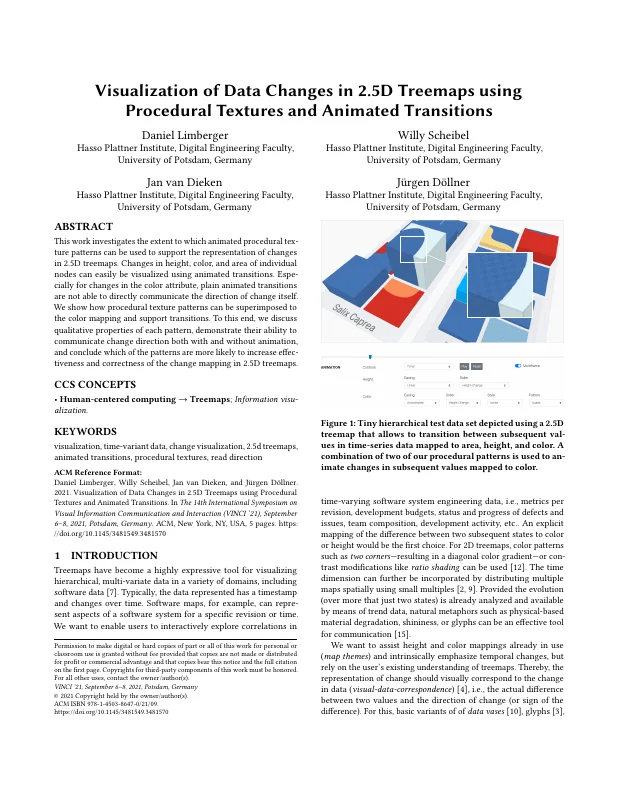
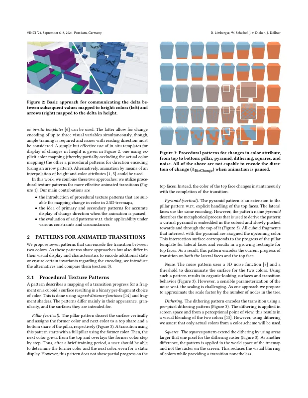
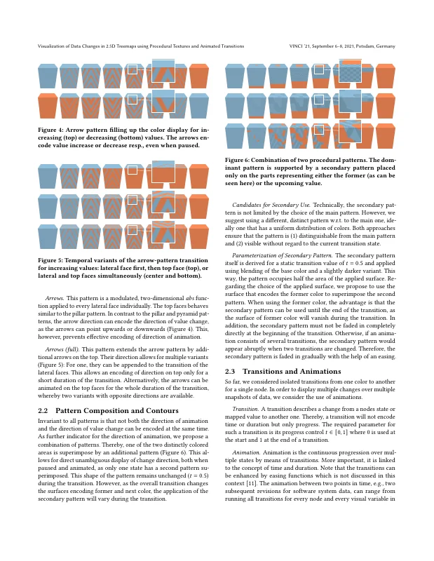
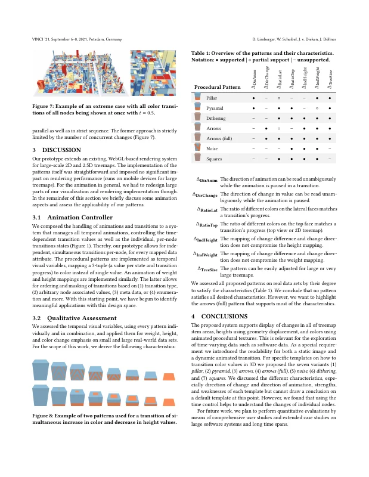
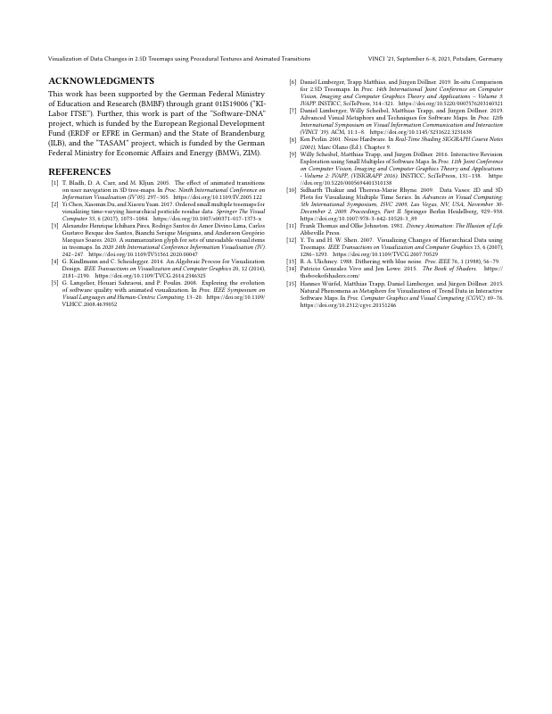

# Visualization of Data Changes in 2.5D Treemaps using Procedural Textures and Animated Transitions

[Daniel Limberger](https://orcid.org/0000-0002-9111-4809), [Willy Scheibel](https://orcid.org/0000-0002-7885-9857), Jan van Dieken, and [Jürgen Döllner](https://orcid.org/0000-0002-8981-8583)

*Proceedings of the 14th International Symposium on Visual Information Communication and Interaction (VINCI '21)*, September 6–8, 2021, Potsdam, Germany. ACM, pp. 21:1–5.

[](https://doi.org/10.1145/3481549.3481570) [](https://doi.org/10.5281/zenodo.24056028) · [ResearchGate](https://www.researchgate.net/publication/354331984)

> This work investigates the extent to which animated procedural texture patterns can be used to support the representation of changes in 2.5D treemaps.
> Changes in height, color, and area of individual nodes can easily be visualized using animated transitions.
> Especially for changes in the color attribute, plain animated transitions are not able to directly communicate the direction of change itself.
> We show how procedural texture patterns can be superimposed to the color mapping and support transitions.
> To this end, we discuss qualitative properties of each pattern, demonstrate their ability to communicate change direction both with and without animation, and conclude which of the patterns are more likely to increase effectiveness and correctness of the change mapping in 2.5D treemaps.

<p><a href="limberger2021-procedural-as-submitted.pdf"></a> <a href="limberger2021-procedural-as-submitted.pdf"></a> <a href="limberger2021-procedural-as-submitted.pdf"></a> <a href="limberger2021-procedural-as-submitted.pdf"></a></p>
<details><summary>Remaining page</summary><p><a href="limberger2021-procedural-as-submitted.pdf"></a></p></details>

## Contents

- [`src/`](src/) – LaTeX sources of the camera-ready version (ACM `acmart`, sigconf)
- [`limberger2021-procedural-as-submitted.pdf`](limberger2021-procedural-as-submitted.pdf) – camera-ready PDF as submitted to ACM
- [`build.sh`](build.sh) – reproducible build with TeX Live 2021 (podman or docker)
- [`preview/`](preview/) – page previews for this README

## Build

```bash
./build.sh        # → build/article.vinci-procedural-textures.pdf
```

The bundled `acmart.cls` (2021) is not compatible with current TeX Live releases (`hyperxmp` load-order error), hence the TeX Live 2021 container.
On `main`, the build produces the revised version (`v1.2-revised`). Check out `v1.0-camera-ready` to reproduce `limberger2021-procedural-as-submitted.pdf` (identical text and layout; figure captions differ marginally in glyph rendering).

## Versions

- [`v1.0-camera-ready`](https://github.com/dl-archive/article.2021-vinci-procedural-textures/tree/v1.0-camera-ready) – sources as submitted to ACM (2021-09-16)
- [`v1.1-revised`](https://github.com/dl-archive/article.2021-vinci-procedural-textures/tree/v1.1-revised) – superseded by v1.2 (same fixes, but moved lines across columns and pages)
- [`v1.2-revised`](https://github.com/dl-archive/article.2021-vinci-procedural-textures/tree/v1.2-revised) – author's revised version (2026-11-08): typo, grammar and reference fixes with the layout of v1.0, see [Revisions](#revisions)

## Revisions

`v1.2-revised` (2026-11-08) corrects errors in the camera-ready version without changing its content.
Line and page breaks of v1.0 are kept: every page and column starts and ends as in the submitted version.
(`v1.1-revised` contained the same corrections, but some of them moved lines across columns and pages.)
Every page carries the note "Author's revised version (2026-11-08). Version of record: https://doi.org/10.1145/3481549.3481570".

- References: [7] linked the DOI of a different paper (now 10.1145/3356422.3356444); [6] listed "Trapp Matthias" (now "Matthias Trapp"). As a result, [6] and [7] swap their numbers.
- Grammar and typos: "overlaid on" (was "superimposed to"), "allows transitioning", "etc." (was "etc.."), "more than", "physically based", "variants of" (was "of of"), "a procedural pattern", "capable of encoding", "dissects", "extends", "larger than", "behave like" (was "behaves similar"), "superimposed by", "The shape", "w.r.t. the main one", "node's state", "More importantly", "into a system", "transition states", "instead of a single value", "is implemented", "within this design space".
- Metadata: PDF title now has the missing space ("using Procedural"); keyword "2.5d" is now "2.5D".

## Citation

```bibtex
@InProceedings{limberger2021-procedural,
  author    = {Limberger, Daniel and Scheibel, Willy and van Dieken, Jan and D{\"o}llner, J{\"u}rgen},
  title     = {Visualization of Data Changes in 2.5D Treemaps using Procedural Textures and Animated Transitions},
  booktitle = {Proceedings of the 14th International Symposium on Visual Information Communication and Interaction},
  year      = {2021},
  series    = {VINCI~'21},
  publisher = {ACM},
  pages     = {21:1--5},
  doi       = {10.1145/3481549.3481570},
  isbn      = {978-1-450386-47-0},
}
```
